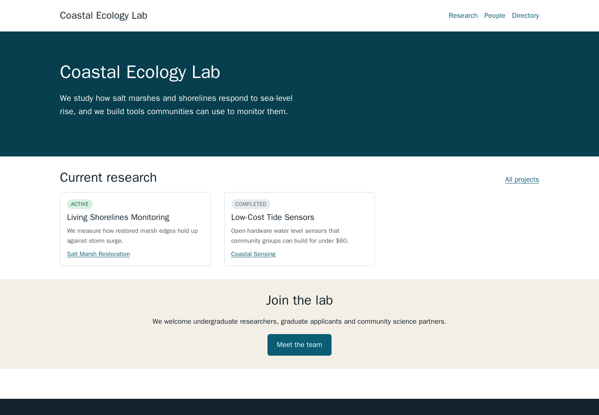
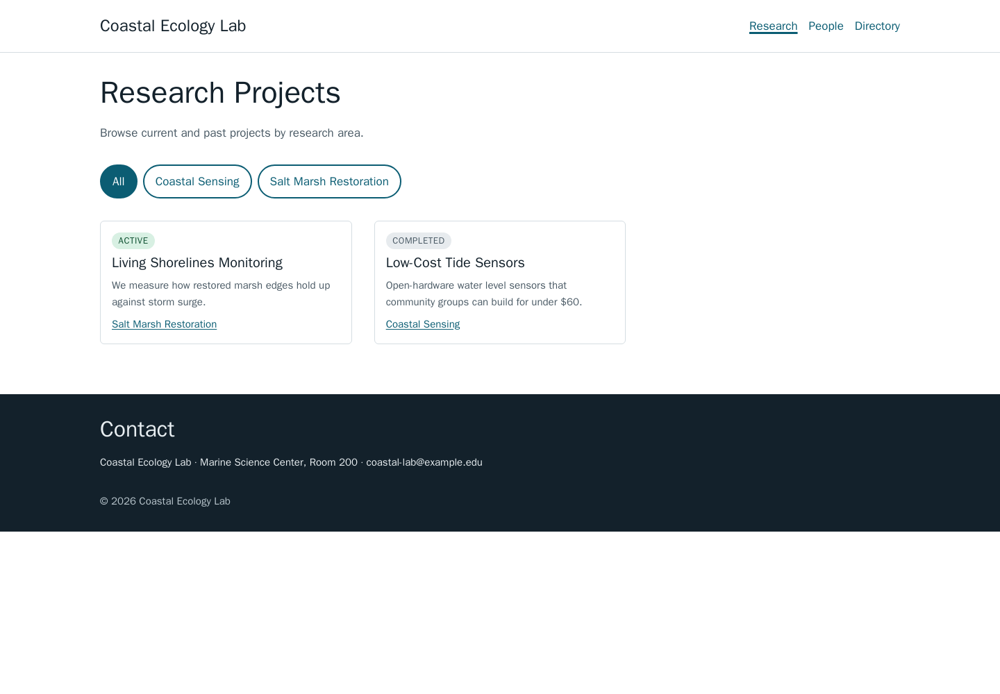
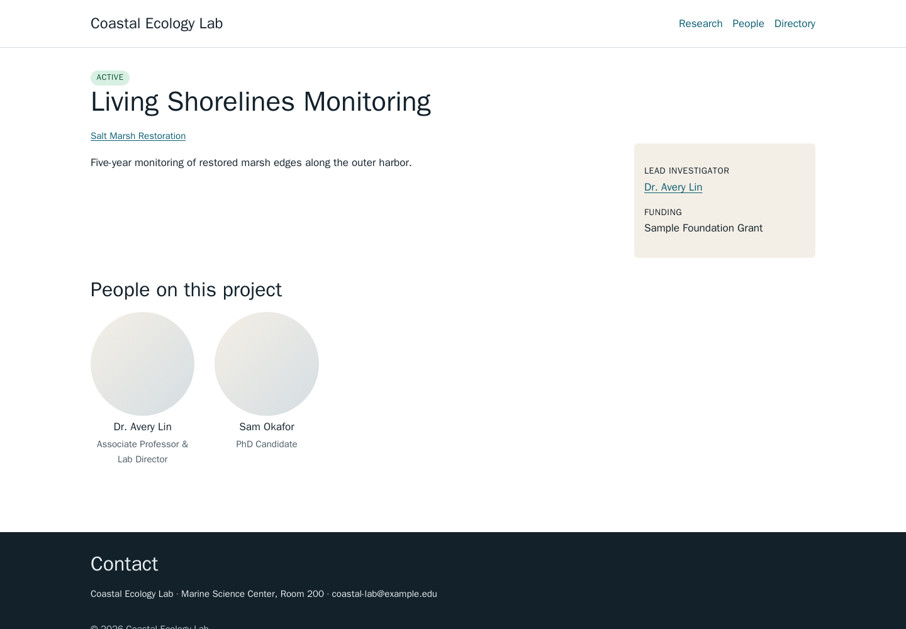
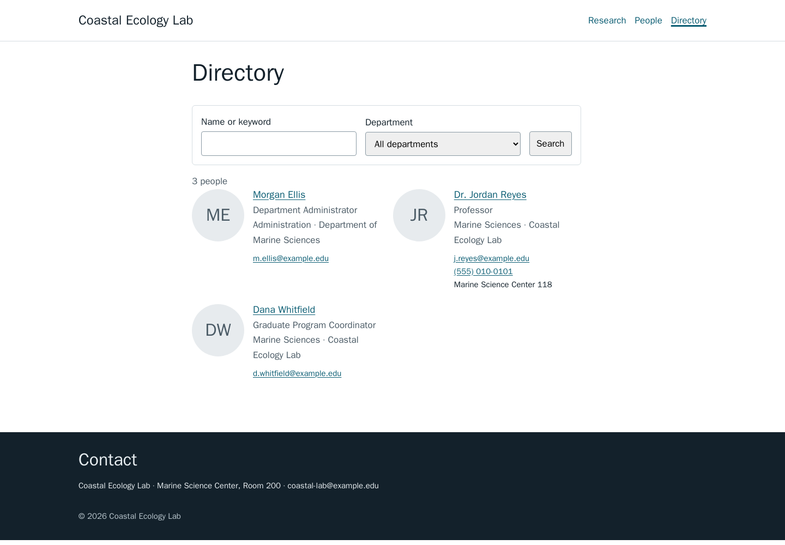
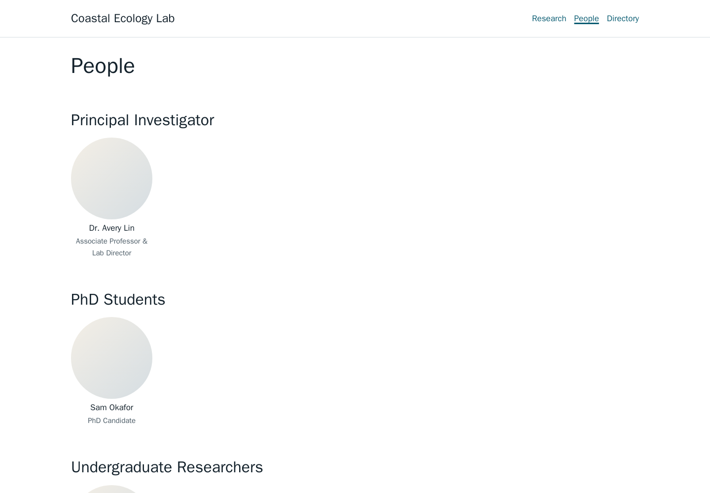
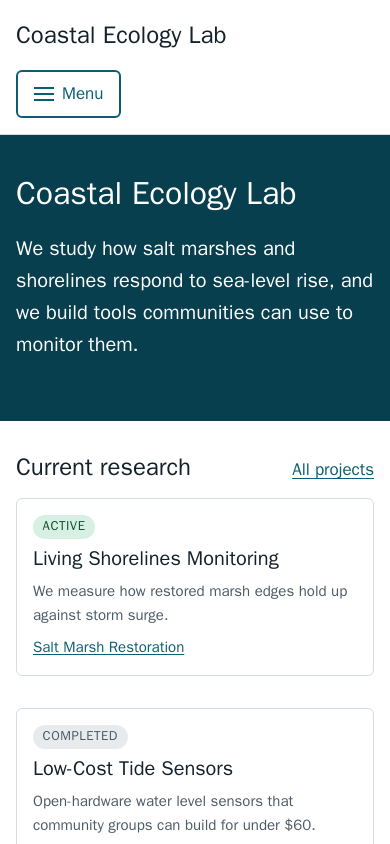
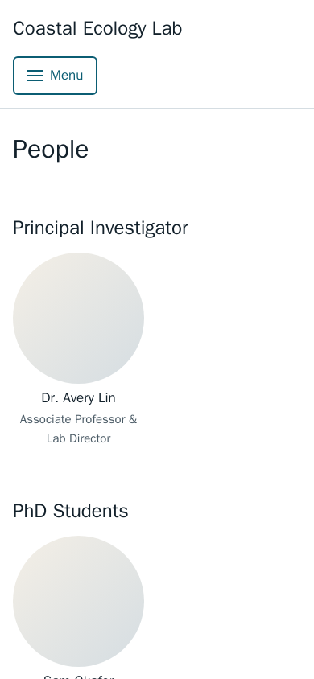

# Campus WordPress Portfolio

A set of WordPress / WordPress Multisite (CampusPress-style) projects built to show the
skills needed to support a university's website work: custom themes, Advanced Custom Fields,
PHP, npm/webpack builds, Git workflow, UX decisions, and written documentation.

The repo is set up like a real agency/department workload: **three sites at three different
stages**, plus the UX and documentation work that ties them together.

| # | Project | Site stage | What it shows |
|---|---------|-----------|----------------|
| 01 | [`coastal-lab` theme](01-research-lab-theme/coastal-lab) | **Near completion**: polish, QA, handoff | Custom theme from scratch, PHP templates, custom post types, ACF field groups, `theme.json`, `@wordpress/scripts` (webpack) build, accessible responsive nav |
| 02 | [`campus-directory` plugin](02-campus-directory-plugin/campus-directory) | **Mid-build**: feature work | Multisite **network-activated** plugin, `switch_to_blog()` aggregation across sites, network admin settings, ACF fields, shortcode, caching, uninstall cleanup |
| 03 | [`marine-dept-divi-child` theme](03-divi-child-theme/marine-dept-divi-child) | **Just starting**: scaffolding | Divi child theme done right: enqueue order, accessibility overrides for Divi modules, Divi filters, a build log for a page-builder site |
| 04 | [UX audit & documentation](04-ux-audit-and-docs) | Across all sites | Heuristic UX audit, before/after information architecture, content model to ACF mapping, WCAG checklist, handoff/status template, IT support ticket template |

## Screenshots

| Home (desktop) | Research archive with filter |
|---|---|
|  |  |
| **Single project (ACF fields + relationships)** | **Network directory (plugin, 2 sites)** |
|  |  |

| People, grouped by role | Mobile home | Mobile people |
|---|---|---|
|  |  |  |

## How the job requirements map to this repo

| Requirement | Where to look |
|-------------|---------------|
| Build/edit responsive pages in WordPress & CampusPress | `01` templates + SCSS, `03` child theme, [docs/campuspress-notes.md](docs/campuspress-notes.md) |
| Complete in-progress projects with little oversight | Each project's `CHANGELOG.md` / status section; [04 handoff template](04-ux-audit-and-docs/project-status-template.md) |
| UX intuition for layout & navigation | [04 UX audit](04-ux-audit-and-docs/ux-audit-marine-sciences.md), `01` nav + filter JS |
| Recommend site structure / content improvements | [04 IA redesign](04-ux-audit-and-docs/information-architecture.md) |
| Advanced Custom Fields | `01/inc/acf.php`, `02/includes/class-fields.php`, [content model](04-ux-audit-and-docs/content-model.md) |
| PHP in a WordPress context | All of `01/inc`, all of `02/includes` |
| Build processes (npm, webpack) | `01/package.json`, `01/webpack.config.js` |
| GitHub: commits, branches, repo management | [docs/git-workflow.md](docs/git-workflow.md), [.github/workflows/ci.yml](.github/workflows/ci.yml) |
| Coordinate with IT support | [04 IT ticket template](04-ux-audit-and-docs/it-support-ticket-template.md) |
| Document changes & site configuration | `01/docs/site-configuration.md`, every `CHANGELOG.md` |

## Run it locally (WordPress Multisite in Docker)

Requires Docker Desktop. Full instructions: [docs/local-setup.md](docs/local-setup.md).

```bash
docker compose up -d
./bin/setup.sh          # installs multisite, ACF, 2 sub-sites, sample content
open http://localhost   # admin: http://localhost/wp-admin  (admin / admin)
```

Build the theme assets (needs Node 22+):

```bash
cd 01-research-lab-theme/coastal-lab
npm install
npm run build           # or: npm start  (watch mode)
```

## Repo layout

```
.
├── 01-research-lab-theme/coastal-lab/        # custom theme (ACF + webpack)
├── 02-campus-directory-plugin/campus-directory/  # multisite network plugin
├── 03-divi-child-theme/marine-dept-divi-child/   # Divi child theme
├── 04-ux-audit-and-docs/                     # UX audit, IA, templates
├── docs/                                     # setup, git workflow, CampusPress notes
├── bin/setup.sh                              # one-shot local multisite provisioning
├── docker-compose.yml
└── .github/workflows/ci.yml                  # build + lint on every PR
```

All organizations and sites in this repo are fictional sample content.
